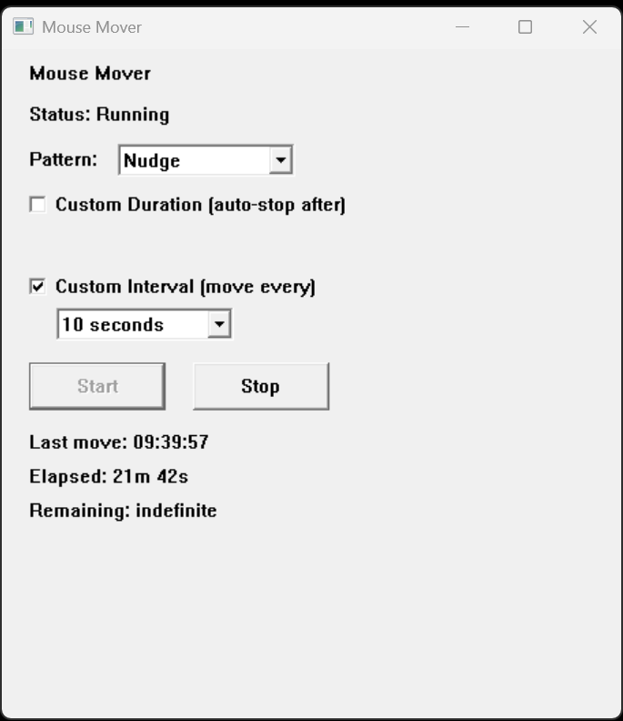
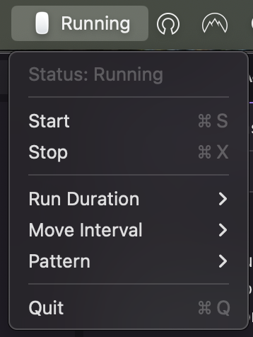

# Mouse Mover — Free Mouse Jiggler for Windows & macOS

**Mouse Mover is a free, open-source mouse jiggler that keeps your computer
awake by automatically moving the mouse cursor a few pixels at a set interval,
then returning it to its original position.** Use it to stop your screen from
sleeping, prevent idle timeouts, and keep your status active — without any
administrator privileges, background services, or telemetry.

Available for **Windows 10/11** and **macOS** (Apple Silicon and Intel).

[](https://github.com/alvinjaison/mouse-mover/actions/workflows/ci.yml)
[](https://github.com/alvinjaison/mouse-mover/releases/latest)
[](LICENSE)
[](https://goreportcard.com/report/github.com/jarvis/mouse-mover)
[](#download)

> **Keywords:** mouse jiggler, mouse mover, keep PC awake, prevent screen from
> sleeping, prevent idle / away status, no-sleep utility, cursor mover —
> lightweight, portable, and open source.

---

## Screenshots

### Windows

The Windows build is a native window with a Start/Stop control, pattern and
interval selectors, and live status (last move, elapsed, remaining). It also
minimizes to the system tray.



### macOS

The macOS build is a lightweight menu bar app (no dock icon, no window). Click
the mouse icon in the menu bar for Start/Stop, Run Duration, Move Interval, and
Pattern.



---

## Features

- **Keeps your session active** — periodic, minimal cursor movement resets idle
  and sleep timers.
- **Start/Stop in one click** — from a window (Windows) or the menu bar (macOS).
- **Configurable intervals** — 10s, 30s, 1m, 2m, 5m, or a custom value.
- **Auto-stop after a duration** — run for 30m, 1h, 2h, 4h, 8h, or indefinitely.
- **Movement patterns** — Nudge, Jiggle, or Square.
- **Returns the cursor** — every move snaps the pointer back to where it was.
- **Multi-monitor aware** — clamps movement to the virtual-screen bounds.
- **No admin, no service, no network** — runs as a standard user, offline, with
  zero telemetry.
- **Portable** — a single executable you can run from anywhere.
- **Open source (MIT)** — audit it, build it, fork it.

## Why use a mouse mover?

Many apps show you as "away" or "idle" after a short period, and laptops dim or
sleep the screen to save power. A mouse mover (also called a *mouse jiggler*)
periodically simulates a tiny amount of movement so the system and apps treat
your session as active. Mouse Mover does this **transparently** — it is fully
visible to Task Manager / Activity Manager and security software, synthesizes
only mouse movement (never keyboard input), and never tries to hide itself or
bypass security policy.

## Download

Grab the latest build from the
**[Releases page](https://github.com/alvinjaison/mouse-mover/releases/latest)**:

| Platform | File | Notes |
| --- | --- | --- |
| Windows 10/11 | `MouseMover.exe` or `MouseMover-portable.zip` | Portable, single exe |
| macOS (Apple Silicon + Intel) | `MouseMover-macos-universal.zip` | Universal `.app` bundle |

The binaries are **unsigned**, so your OS may warn on first launch — see
[Installation](#installation).

## Installation

### Windows

1. Download `MouseMover.exe` (or unzip `MouseMover-portable.zip`).
2. Double-click to run. No installation or admin rights required.
3. If Windows SmartScreen warns, click **More info → Run anyway** (the exe is
   unsigned).

Optional per-user install with a Start Menu shortcut (no admin):

```powershell
powershell -ExecutionPolicy Bypass -File build\install-user.ps1
```

### macOS

1. Download and unzip `MouseMover-macos-universal.zip`.
2. Drag **MouseMover.app** to `/Applications`.
3. The app is unsigned, so right-click it → **Open** → **Open** to bypass
   Gatekeeper on first launch.
4. Look for the **mouse icon in the menu bar** (top-right). There is no window —
   the menu is the interface.
5. On the first movement, macOS asks for **Accessibility** permission. Grant it
   under **System Settings → Privacy & Security → Accessibility**, then Start
   again.

## Usage

1. Choose a **move interval** (how often the cursor nudges).
2. Optionally set a **run duration** so it auto-stops.
3. Pick a **movement pattern** (Nudge, Jiggle, Square).
4. Click **Start**. The cursor moves a few pixels each interval and returns.
5. Click **Stop** (or **Quit** on macOS) when you're done.

## Build from source

Requires **Go 1.23+**.

```bash
git clone https://github.com/alvinjaison/mouse-mover.git
cd mouse-mover

# Run the cross-platform tests:
go test ./...

# Build the Windows exe (cross-compiles from any OS, no C toolchain needed):
bash build/build.sh

# Build the macOS universal binary (requires a Mac with Xcode CLT):
bash build/build-mac.sh
```

See [CONTRIBUTING.md](CONTRIBUTING.md) for development details.

## How it works

Mouse Mover is a single Go module with a layered design:

```
cmd/mousemover/       Entry point (Windows, macOS, and build-only stub)
internal/
  engine/             Cancellable movement scheduler (platform-agnostic, tested)
  config/             JSON settings + validation
  winapi/             Cursor bindings (Win32 on Windows, Core Graphics on macOS)
  ui/                 Native Win32 window + tray / Cocoa menu bar app
build/                Build, package, and install scripts
docs/                 Design documentation and screenshots
```

The engine depends only on a `CursorController` interface, so it is fully unit
tested on any OS with a fake cursor. The full design is documented in
[docs/DESIGN.md](docs/DESIGN.md).

## FAQ

**Is Mouse Mover free?**
Yes. It's free and open source under the MIT license.

**Does it need administrator rights?**
No. It runs entirely as a standard user — no UAC elevation, no service, no
machine-wide install.

**Does it collect any data or connect to the internet?**
No. There is no telemetry and no network access of any kind.

**Will it keep my screen awake / stop me from going idle?**
That's the goal. Synthetic mouse movement resets most idle and sleep timers.
Some environments block this (see Limitations).

**Does it move the keyboard or type anything?**
No. It only simulates mouse movement — never keyboard input.

**Is it a virus?**
No. The source is fully open for you to inspect and build yourself. The released
binaries are unsigned, which is why your OS may warn on first run.

**Does it work on Linux?**
The GUI and cursor control are Windows- and macOS-only. Linux can build and run
the test suite but has no GUI target.

## Limitations

Mouse Mover is unprivileged by design and will **not** bypass OS or enterprise
security controls:

- **Windows:** enterprise policy, UIPI, or Secure Desktop (UAC prompt, lock
  screen) can block synthetic input.
- **macOS:** requires Accessibility permission; does not work on the lock
  screen.
- **Session lock:** movement has no effect while the session is locked.
- **No keyboard simulation:** only mouse movement is performed.

## Contributing

Contributions are welcome! Please read [CONTRIBUTING.md](CONTRIBUTING.md) and our
[Code of Conduct](CODE_OF_CONDUCT.md). For security issues, see
[SECURITY.md](SECURITY.md).

## License

Released under the [MIT License](LICENSE).
